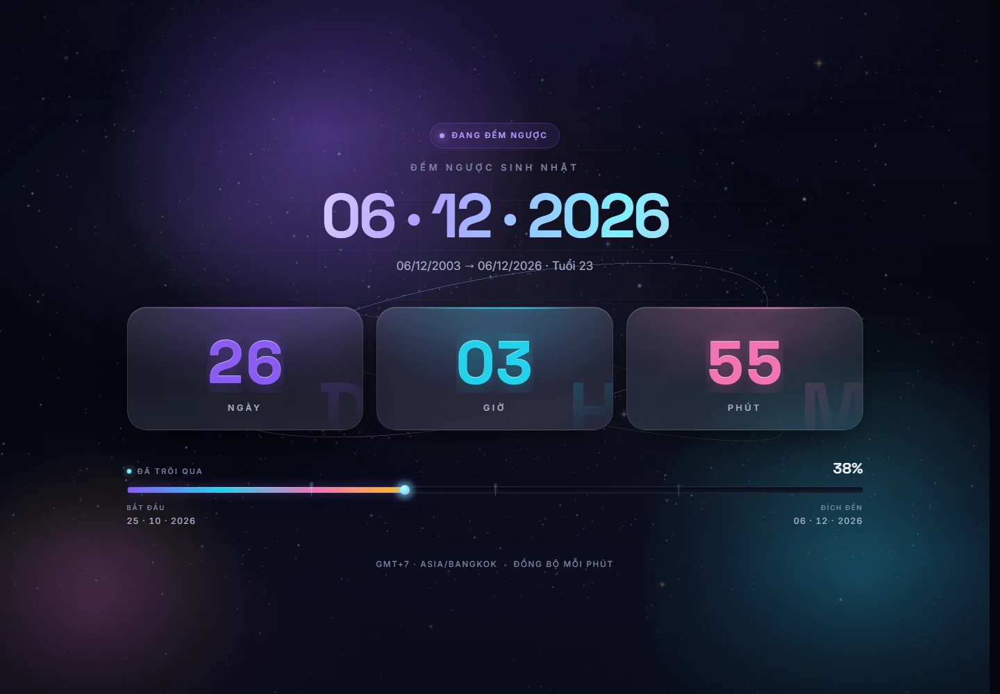
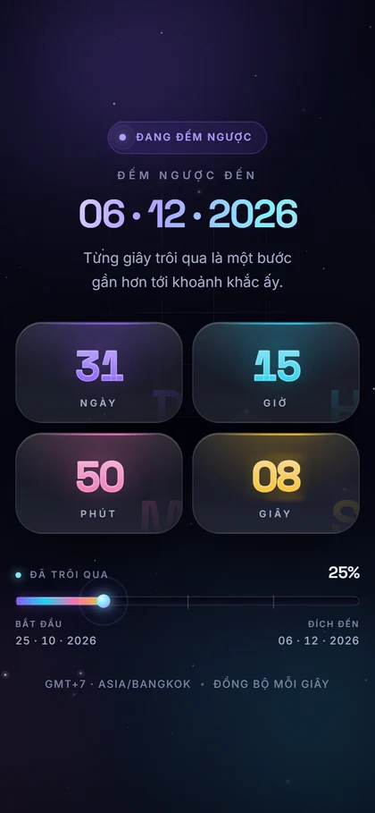
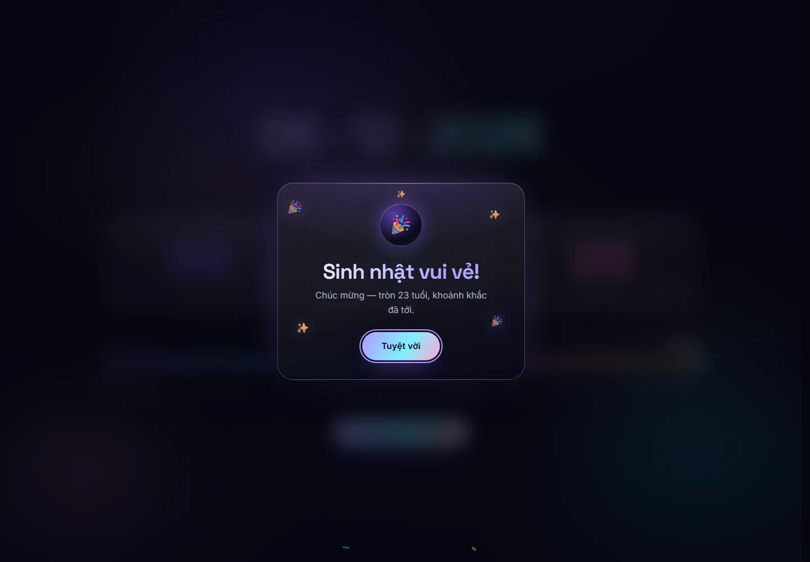

# Aurora Countdown — đếm ngược sinh nhật 06 · 12 · 2026

Một trang đếm ngược một màn hình cho ngày **06/12/2026** (sinh nhật, tròn 23 tuổi kể từ
06/12/2003). Giao diện theo hướng space launch: nền tinh vân WebGL, thẻ số odometer kính
mờ, thanh tiến trình chiến dịch và màn ăn mừng confetti. Toàn bộ chạy offline sau build.

| Desktop | Mobile |
| --- | --- |
|  |  |



## Tính năng

- **Đếm ngược theo đồng hồ thực** — mỗi tick đọc lại `Date.now()` rồi hẹn giờ tới mốc
  phút kế tiếp, nên không bị trôi như `setInterval`; đồng bộ lại khi tab được focus.
  Giao diện chỉ có ba đơn vị: **ngày / giờ / phút**, dữ liệu cập nhật mỗi phút.
- **Nền tinh vân WebGL (three.js)** — 3 lớp sao theo chiều sâu, 2 quỹ đạo bụi, các tinh
  vân màu và lõi sáng. Camera parallax theo con trỏ, mỗi phút có một nhịp sáng nhẹ.
  Vòng lặp giữ ở 30fps, DPR tối đa 1.25 (1.0 khi viewport hẹp hoặc trỏ thô), giảm mật
  độ điểm trên mobile. `three` được `import()` động nên nằm ở chunk riêng, không chặn
  lần vẽ đầu; trình duyệt không có WebGL tự hạ cấp về starfield canvas 2D.
- **Odometer & chuyển động** — hero, thẻ và rail vào theo nhịp stagger một lần; tiêu đề
  "06 · 12 · 2026" lơ lửng nhẹ (translateY 9px, chu kỳ 6s, bắt đầu sau entrance); số cuộn
  bằng cột 0–9 dịch `transform`, giữ nguyên bề rộng nên layout không nhảy; nền có aurora
  drift và quỹ đạo quay rất chậm. Thẻ chỉ có aura tĩnh, không phản ứng theo con trỏ.
- **Thanh tiến trình chiến dịch** — mốc bắt đầu 25.10.2026, đích 06.12.2026; phần trăm
  chạy realtime, vạch chia 25/50/75%, đầu rail phát sáng.
- **Celebration** — khi về 0: dialog kính mờ, confetti hai bên và giữa, đóng bằng
  Escape / backdrop / nút; nền chuyển sang tông hổ phách.
- **A11y & offline** — progressbar có `aria-valuetext`, thẻ có `aria-label`, dialog có
  `aria-modal` + focus restore; chuyển động tôn trọng `prefers-reduced-motion`. Font
  self-host, không CDN/ảnh ngoài; texture WebGL vẽ bằng canvas trong bundle.

## Công nghệ

| Thành phần | Vai trò |
| --- | --- |
| React 19 + Vite 8 | UI + build |
| `three` (three.js) | nền tinh vân WebGL, import động thành chunk riêng |
| `@fontsource-variable/space-grotesk` | font tiêu đề, self-hosted |
| `@fontsource-variable/inter` | font nội dung, self-hosted |
| oxlint | lint |

Không dùng UI/CSS framework và không dùng thư viện animation. Mọi chuyển động viết bằng
CSS + JS thuần: odometer trong `src/components/Odometer.jsx`, hook
`src/lib/use-reduced-motion.js`, confetti canvas 2D trong `src/lib/confetti.js`.

## Cấu trúc

```
src/
  App.jsx                  # composition + trạng thái celebration, nối tick xuống nền
  App.css, index.css       # layout shell; reset + design tokens + base layer
  main.jsx                 # mount React, bọc ErrorBoundary
  lib/
    countdown.js           # logic thuần: computeRemaining, progressRatio, format…
    countdown.test.js      # test logic đếm ngược
    motion-guard.test.js   # quét CSS: animation phải có reduced-motion
    use-reduced-motion.js  # hook reactive theo matchMedia
    confetti.js            # burstConfetti(canvas, opts), tự dừng sau 2.5s
  hooks/useCountdown.js    # timer bù trôi, tick tới mốc phút kế tiếp
  components/
    BackgroundFX.jsx/.css  # aurora, grid, grain, vignette + <NebulaScene />
    NebulaScene.jsx/.css   # nền WebGL three.js (stars, flares, orbits, nebula)
    StarField.jsx          # canvas 2D dự phòng khi không có WebGL
    CountdownGrid.jsx/.css # hàng 3 thẻ
    CountdownCard.jsx/.css # thẻ kính + Odometer
    Odometer.jsx/.css      # cột chữ số 0–9 dịch bằng transform
    ProgressRail.jsx/.css  # thanh tiến trình chiến dịch
    Celebration.jsx/.css   # dialog + confetti
    ErrorBoundary.jsx      # panel tải lại khi render lỗi
scripts/
  shot.mjs                 # chụp ảnh + đo layout qua Chrome DevTools Protocol
docs/                      # ảnh preview
DESIGN_CONTRACT.md         # quy ước thiết kế & token
```

## Chạy local

```bash
npm install
npm run dev       # http://localhost:5173/countdown/
```

## Build & deploy

```bash
npm run build     # xuất dist/
npm run preview   # http://localhost:4173/countdown/
npx gh-pages -d dist   # cập nhật nhánh gh-pages
```

Trang live chạy trên GitHub Pages tại `/countdown/`, nội dung là `dist/` của nhánh
`gh-pages`; `vite.config.js` đã đặt `base: '/countdown/'`. Có thể deploy tay bằng cách
đẩy toàn bộ `dist/` lên nhánh `gh-pages` và bật Pages cho nhánh đó. Không cần server,
không có request mạng nào lúc chạy.

## Kiểm thử

```bash
npm run lint      # oxlint, 0 warning
npm test          # node --test, 37 test
npm run build     # pass
node scripts/shot.mjs --width 390 --height 844 --out .shots/mobile.png --mobile
```

`shot.mjs` chụp ảnh qua Chrome DevTools Protocol và in ra `horizontalOverflow`,
`pageHeight`, lỗi console cùng block `nebula` (`canvas` / `webgl` / `fallback`). Các cờ
hữu ích: `--expired`, `--reduced`, `--toggle-reduced`.

### Đã kiểm chứng

| Kiểm tra | Kết quả |
| --- | --- |
| `npm run lint` | 0 warning |
| `npm test` | 37/37 pass |
| `npm run build` | pass; main JS 249.71 kB (gzip 78.54 kB), CSS 32.16 kB (gzip 7.63 kB), chunk `three` 742.80 kB (gzip 187.69 kB, tải sau khi mount) |
| 360×780 / 390×844 / 1440×1000 | không overflow ngang, `pageHeight` = viewport, không lỗi console |
| Nền WebGL | `nebula = {canvas:true, webgl:true, fallback:false}` |
| Expired + reduced-motion | dialog mở đúng, confetti và chuyển động bị tắt, nền WebGL chỉ vẽ một frame tĩnh |

## Ghi chú thiết kế

- Design token nằm trong `src/index.css`; component không hard-code màu.
- Chỉ animate `transform`, `opacity`, `filter`; hiệu ứng vào trang chạy một lần, sau đó
  trang gần như tĩnh để không đốt CPU/GPU.
- Chi tiết token, API component và a11y nằm trong `DESIGN_CONTRACT.md`.
